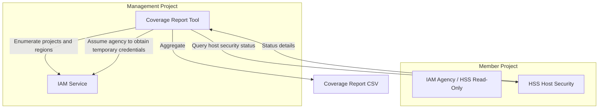

# Host Security Cross-Project Coverage Report

> This repository is a cloud-native best practice running on Huawei Cloud. It provides a unified approach to inspect host security protection coverage across multiple projects and produce an auditable coverage report.

[](LICENSE)
[](https://support.huaweicloud.com/intl/en-us/)

## 1. Overview

In multi-project scenarios, security operators often struggle to know which hosts in each project are not yet enrolled in host security protection, or which hosts have a protection agent that is not reporting normally. This practice provides a lightweight solution:

- A Python tool runs in a central management project.
- It automatically enumerates the managed projects and regions.
- It reads each project's host security status through a pre-established IAM agency.
- It aggregates the results into a coverage report (CSV), labeling each host's protection conclusion (healthy / unprotected / agent abnormal).

Intended audience: security operations teams that need to take periodic inventory and continuous inspection of the host security posture across projects.

## 2. Architecture



## 3. Key Features

- **Unified inspection**: one run covers multiple projects and regions, replacing manual per-project checks.
- **Least privilege**: cross-project read-only access is implemented via an IAM agency; no long-term keys are shared, and permissions are scoped to HSS read-only.
- **Infrastructure as code**: the agency is created and managed through Terraform, making it repeatable, auditable, and version-controlled.
- **Ready to use**: pure Python implementation with minimal dependencies, outputting a standard CSV for spreadsheets or downstream alerting.

## 4. Cloud Services

- **IAM (Identity and Access Management)**: carries the cross-project read-only agency authorization.
- **HSS (Host Security Service)**: provides the data source of each host's protection status.
- **Terraform + huaweicloud Provider**: deploys the agency as code.

## 5. Prerequisites

- Access keys (AK/SK) of a management project, used to run the report tool.
- Permission to create an IAM agency in each member project.
- Local environment with:
  - Python 3.9 or later
  - Terraform >= 1.5
- HSS enabled in each member project.

## 6. Quick Start

```bash
# 1. Install dependencies
python3 -m venv .venv && source .venv/bin/activate
python3 -m pip install -r requirements.txt

# 2. Configure management project credentials and delegated domain
export HW_ACCESS_KEY="<management project AK>"
export HW_SECRET_KEY="<management project SK>"
export HW_DELEGATED_DOMAIN_ID="<member project domain ID>"

# 3. Inspect all projects and regions
python3 src/coverage_report.py --agency-name HssCoverageAgency --all-projects --all-regions
```

`report.csv` is generated in the current directory.

## 7. Deployment

### 7.1 Create the agency in each member project

For each member project, enter the infrastructure directory and deploy:

```bash
cd infra
export HW_ACCESS_KEY="<member project AK>"
export HW_SECRET_KEY="<member project SK>"
terraform init
terraform apply -var="management_domain_name=<management project domain name>"
```

### 7.2 Configure and run the tool in the management project

```bash
cd <repository root>
source .venv/bin/activate
export HW_ACCESS_KEY="<management project AK>"
export HW_SECRET_KEY="<management project SK>"
export HW_DELEGATED_DOMAIN_ID="<member project domain ID>"
python3 src/coverage_report.py --agency-name HssCoverageAgency --all-projects --all-regions
```

See `docs/deployment-guide.md` for details.

## 8. Usage and Verification

Generate the coverage report:

```bash
python3 src/coverage_report.py \
  --agency-name HssCoverageAgency \
  --project-ids <project-id-1>,<project-id-2> \
  --regions cn-north-4,cn-east-3
```

Expected terminal output:

```
Start iterating
Write results to report.csv
```

The generated `report.csv` looks like:

```
ProjectId,Region,ResourceId,ResourceType,ProtectStatus,AgentStatus,CoverageStatus,Issue
<project-id>,cn-north-4,<host-id>,ECS,opened,ONLINE,HEALTHY,N.A
<project-id>,cn-north-4,<host-id>,ECS,closed,,NO_PROTECTION,Protection disabled
```

Verification points:

- The report is generated successfully and contains a header and data rows.
- The `CoverageStatus` column shows `HEALTHY` / `NO_PROTECTION` / `UNHEALTHY`.
- For abnormal hosts, use the `Issue` column to locate the cause (protection disabled / agent not reporting).

## 9. Cleanup

When the cross-project agency is no longer needed, run in each member project's `infra` directory:

```bash
cd infra
terraform destroy
```

The agency is removed and the associated temporary credentials become invalid, avoiding leftover unused authorization.

## 10. License

This practice is released under the **MIT No Attribution** license.

[](LICENSE)

See the root `LICENSE` file for details.

## 11. Contact

- Maintainer: zhangcheng123321
- Channel: report issues through enterprise support tickets or the relevant technical community.

## 12. Creator / Maintainer

| Role | Account |
| --- | --- |
| **Creator** | zhangcheng123321 |
| **Maintainer** | zhangcheng123321 |
