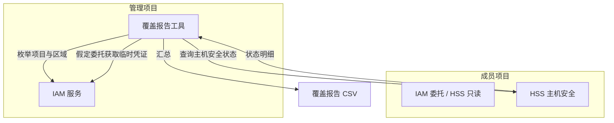

# 主机安全跨项目覆盖报告 / Host Security Cross-Project Coverage Report

> 本仓库为在华为云上落地的云原生最佳实践，用于跨多个项目统一巡检主机安全防护覆盖情况，并输出一份可审计的覆盖报告。

[](LICENSE)
[](https://support.huaweicloud.com/intl/en-us/)
[](#)

## 1. 简介

在多项目场景下，安全运营人员常常难以掌握「每个项目里到底有哪些主机还没有纳入主机安全防护、哪些主机的防护 Agent 没有正常上报」。本实践提供一套轻量方案：

- 由统一的管理项目运行一个 Python 工具；
- 自动枚举所辖项目与区域；
- 通过预先建立的 **IAM 委托** 读取各项目的主机安全防护状态；
- 汇总生成一份覆盖报告（CSV），标注每台主机的防护结论（正常 / 未防护 / Agent 异常）。

适用对象：需要对企业内多项目主机安全态势做统一盘点与持续巡检的安全运营团队。

## 2. 目录

- [简介](#1-简介)
- [架构图](#3-架构图)
- [方案亮点](#4-方案亮点)
- [涉及云服务](#5-涉及云服务)
- [前置条件](#6-前置条件)
- [快速开始](#7-快速开始)
- [分步部署](#8-分步部署)
- [使用方法与验证](#9-使用方法与验证)
- [清理资源](#10-清理资源)
- [详细说明](#11-详细说明)
- [依赖说明](#12-依赖说明)
- [FAQ / 故障排除](#13-faq--故障排除-minor)
- [贡献指南](#14-贡献指南)
- [许可证](#15-许可证)
- [联系方式](#16-联系方式)

## 3. 架构图



## 4. 方案亮点

- **统一巡检**：一次执行，覆盖多个项目与多个区域，告别逐项目手工核对。
- **最小授权**：基于 IAM 委托实现跨项目只读访问，不共享任何长期密钥，权限收敛为 HSS 只读。
- **基础设施即代码**：委托的创建通过 Terraform 管理，可重复、可审计、可纳入版本控制。
- **即开即用**：纯 Python 实现，依赖精简，输出标准 CSV，便于接入表格分析或后续告警流程。

## 5. 涉及云服务

- **IAM（统一身份认证）**：承载跨项目的只读委托授权。
- **HSS（主机安全服务）**：提供各主机安全防护状态的数据源。
- **Terraform + huaweicloud Provider**：以代码方式部署委托。

> 资源释放相关说明见[清理资源](#10-清理资源)章节。

## 6. 前置条件

- 具备一个「管理项目」的访问密钥（AK/SK），用于运行报告工具。
- 对各「成员项目」具备创建 IAM 委托的权限。
- 本机已安装：
  - Python 3.9 及以上
  - Terraform >= 1.5
- 各成员项目已开通主机安全服务（HSS）。

## 7. 快速开始

```bash
# 1. 安装依赖
python3 -m venv .venv && source .venv/bin/activate
python3 -m pip install -r requirements.txt

# 2. 配置管理项目凭据与受托域
export HW_ACCESS_KEY="<管理项目 AK>"
export HW_SECRET_KEY="<管理项目 SK>"
export HW_DELEGATED_DOMAIN_ID="<成员项目所属域 ID>"

# 3. 一键巡检全部项目与区域
python3 src/coverage_report.py --agency-name HssCoverageAgency --all-projects --all-regions
```

执行后会在当前目录生成 `report.csv`。

## 8. 分步部署

### 8.1 在成员项目创建委托

对每个成员项目，进入基础设施目录并部署：

```bash
cd infra
export HW_ACCESS_KEY="<成员项目 AK>"
export HW_SECRET_KEY="<成员项目 SK>"
terraform init
terraform apply -var="management_domain_name=<管理项目域名>"
```

### 8.2 在管理项目配置并运行工具

```bash
cd <本仓库根目录>
source .venv/bin/activate
export HW_ACCESS_KEY="<管理项目 AK>"
export HW_SECRET_KEY="<管理项目 SK>"
export HW_DELEGATED_DOMAIN_ID="<成员项目所属域 ID>"
python3 src/coverage_report.py --agency-name HssCoverageAgency --all-projects --all-regions
```

详细说明见 `docs/deployment-guide.md`。

## 9. 使用方法与验证

运行以下命令生成覆盖报告：

```bash
python3 src/coverage_report.py \
  --agency-name HssCoverageAgency \
  --project-ids <项目ID1>,<项目ID2> \
  --regions cn-north-4,cn-east-3
```

预期输出（终端）：

```
开始迭代
写入结果到 report.csv
```

生成的 `report.csv` 形如：

```
ProjectId,Region,ResourceId,ResourceType,ProtectStatus,AgentStatus,CoverageStatus,Issue
<project-id>,cn-north-4,<host-id>,ECS,opened,ONLINE,HEALTHY,N.A
<project-id>,cn-north-4,<host-id>,ECS,closed,,NO_PROTECTION,Protection disabled
```

验证要点：

- 报告成功生成且包含表头与数据行；
- `CoverageStatus` 列出现 `HEALTHY` / `NO_PROTECTION` / `UNHEALTHY` 三类结论；
- 对防护异常主机，可结合 `Issue` 列定位原因（未开启防护 / Agent 未正常上报）。

> **部署完成后的验证提示**：请在真实环境中按上述步骤实际执行一次，确认报告可正常生成、字段含义与业务预期一致，方可视为交付完成。

## 10. 清理资源

不再需要跨项目委托时，可在各成员项目的 `infra` 目录下执行：

```bash
cd infra
terraform destroy
```

执行后委托被移除，相关临时凭证随之失效，避免遗留未使用的授权。

## 11. 详细说明

### 覆盖结论判定

| 防护开关 | Agent 状态 | 覆盖结论 | 说明 |
|---|---|---|---|
| 已开启 | ONLINE | HEALTHY | 防护正常 |
| 已开启 | 非 ONLINE | UNHEALTHY | Agent 未正常上报 |
| 未开启 | — | NO_PROTECTION | 主机未纳入防护 |

若某（项目, 区域）下没有任何主机记录，会在报告中以 `No Coverage Detected` 标注，提示该范围尚未纳管任何主机。

### 报告字段

- `ProjectId`：成员项目 ID
- `Region`：区域
- `ResourceId`：主机 ID
- `ResourceType`：资源类型（当前为 ECS）
- `ProtectStatus`：防护开关状态
- `AgentStatus`：防护 Agent 状态
- `CoverageStatus`：覆盖结论
- `Issue`：问题说明

### 参数说明

| 参数 | 含义 |
|---|---|
| `--agency-name` | 成员项目中创建的 IAM 委托名称（须已存在） |
| `--all-projects` | 枚举当前账号可访问的全部项目 |
| `--project-ids` | 逗号分隔的项目 ID 列表 |
| `--all-regions` | 枚举全部区域 |
| `--regions` | 逗号分隔的区域列表 |
| `--enterprise-project-id` | 可选，按企业项目过滤主机 |
| `--output` | 输出 CSV 路径，默认 `report.csv` |

## 12. 依赖说明

主要依赖：

- `huaweicloudsdkcore` / `huaweicloudsdkiam` / `huaweicloudsdkhss`（版本见 `requirements.txt`）

## 13. FAQ / 故障排除 [MINOR]

**Q：执行时报「缺少受托域 ID」？**
请在管理项目运行环境中设置环境变量 `HW_DELEGATED_DOMAIN_ID`，取值为成员项目所属域的 ID。

**Q：报告里某个项目没有任何主机？**
说明该项目的 HSS 尚未纳管任何主机，或该项目下没有 ECS 资源，报告中会显示为 `No Coverage Detected`。

**Q：能否只巡检部分项目？**
可以，使用 `--project-ids` 与 `--regions` 显式指定范围，替代 `--all-projects` / `--all-regions`。

## 14. 贡献指南

欢迎通过仓库的 Issue / Pull Request 渠道提交改进建议。提交前请确保：

- 新增依赖在 `requirements.txt` 中钉死版本；
- Terraform 改动通过 `terraform fmt` 与 `terraform validate`；
- 文档保持与代码一致。

## 15. 许可证

本实践采用 **MIT No Attribution** 许可证。

[](LICENSE)

详见根目录 `LICENSE` 文件。

## 16. 联系方式

- 维护者：zhangcheng123321
- 交流渠道：通过企业支持工单或对应技术社区反馈问题

## 17. 创建者 / 维护者

| 角色 | 账号 |
| --- | --- |
| **创建者** | zhangcheng123321 |
| **维护者** | zhangcheng123321 |
