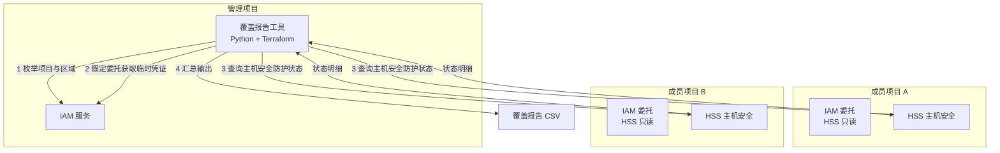

# 架构说明

本实践提供一套跨项目的**主机安全覆盖巡检**方案：在统一管理项目上运行一个轻量工具，自动枚举所辖项目与区域，读取各项目的主机安全防护状态，并汇总为一份覆盖报告。目标是让安全运营人员一眼看清「哪些主机尚未开启防护、哪些主机的防护 Agent 未正常上报」。

## 整体架构

## 关键设计

### 1. 跨项目凭证：IAM 委托（Delegation）

统一工具运行在「管理项目」中。每个「成员项目」内预先创建一个 **IAM 委托**，其受托方设为管理项目域名，并授予 **HSS 只读** 权限。工具凭借管理项目自身的访问密钥，通过「假定委托」获取各成员项目的临时访问密钥，从而在不共享长期密钥的前提下读取成员项目的主机安全数据。

### 2. 覆盖判定逻辑

对每台主机，结合两项状态得出结论：

| 防护开关 (protect_status) | Agent 状态 (agent_status) | 覆盖结论 | 说明 |
|---|---|---|---|
| 已开启 | ONLINE | HEALTHY | 防护正常 |
| 已开启 | 非 ONLINE | UNHEALTHY | Agent 未正常上报 |
| 未开启 | — | NO_PROTECTION | 主机未纳入防护 |

若某个（项目, 区域）下没有任何主机记录，则在该行标注 `No Coverage Detected`，提示该范围未纳管任何主机。

### 3. 报告输出

工具将结果写入 CSV，列包含：项目 ID、区域、资源 ID、资源类型、防护开关、Agent 状态、覆盖结论、问题说明。运营人员可直接用表格软件打开，或接入后续的分析/告警流程。

## 涉及的组件

- **IAM 委托**：承载跨项目的只读授权。
- **HSS（主机安全服务）**：提供各主机的安全防护状态数据源。
- **Terraform + huaweicloud Provider**：以基础设施即代码方式部署委托。
- **Python 工具**：完成枚举、查询与报告生成。

## 可选增强

如需将报告集中留存，可将生成的 CSV 上传到 OBS 桶，或接入消息通知服务向安全运营群推送异常清单。本实践默认聚焦报告生成，上述增强可按需叠加。
